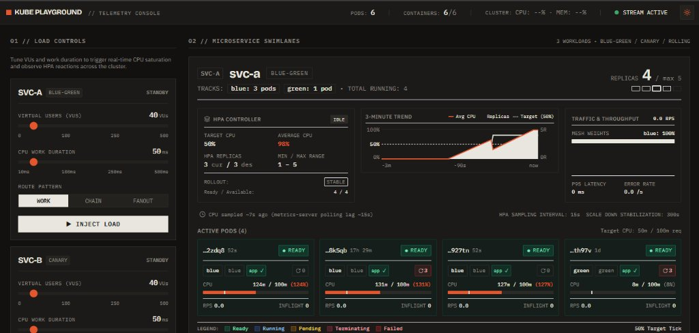
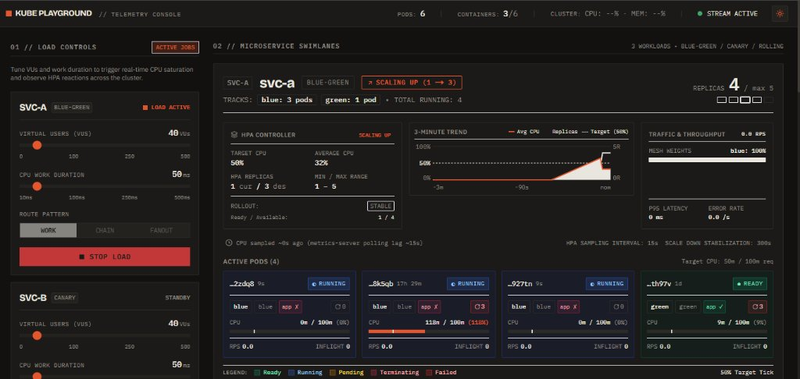
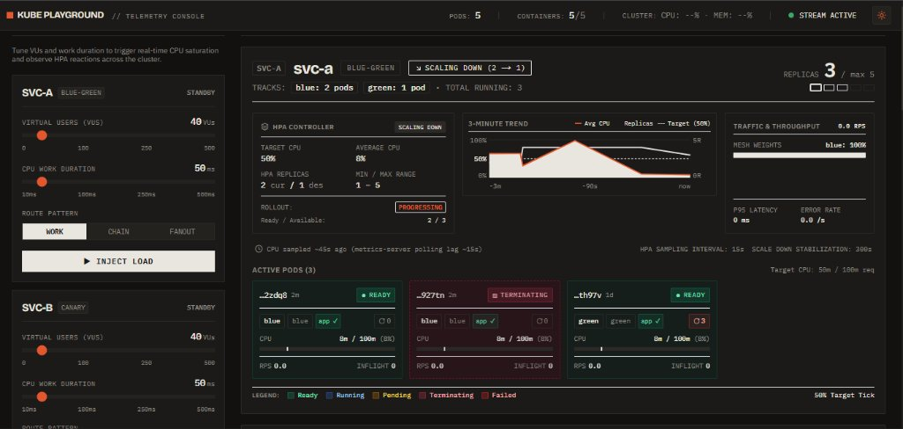

# Kube Playground

> An interactive, observable Kubernetes laboratory for exploring microservices orchestration, real-time autoscaling, and traffic dynamics under live load.

---

## Overview

**Kube Playground** is a local, hands-on Kubernetes learning and experimentation environment. It brings together a multi-tier microservice architecture, real-time metrics collection, in-cluster load generation, and an interactive dashboard.

Instead of working with opaque black-box services or static examples, Kube Playground gives developers and platform engineers immediate visual feedback on cluster mechanics: observe pods launch and terminate in response to CPU saturation, watch the Horizontal Pod Autoscaler (HPA) react dynamically, inspect service-to-service call graphs, and control load generation directly from a web UI.

---

## Live Telemetry Dashboard & Pod Lifecycle

The dashboard provides real-time visibility into the cluster state through an event-driven Server-Sent Events (SSE) telemetry stream. Pods dynamically transition through their authentic Kubernetes lifecycle states with distinct color coding, CPU gauges relative to the 50% HPA target, dual-container readiness chips (`app`, `mesh`), and throughput metrics:

### 1. Ready State (`● READY`)
*Pods are healthy, container readiness probes have passed (`app ✓`, `mesh ✓`), and workloads are actively handling incoming traffic with stable CPU utilization.*



### 2. Running & Scaling Up State (`◐ RUNNING` / `Scaling Up`)
*Triggered under load injection: the Horizontal Pod Autoscaler (HPA) detects CPU saturation above the 50% target threshold and scales out new replicas. Transitional pods enter the running state while containers initialize.*



### 3. Terminating & Scaling Down State (`▨ TERMINATING` / `Scaling Down`)
*When traffic load ceases and CPU utilization subsides below target, the HPA stabilization window engages. Kubernetes gracefully drains and terminates excess replicas, visualized with hatched red styling.*



---

## Problem Statement

Understanding Kubernetes mechanics—such as Pod lifecycles, Horizontal Pod Autoscaling (HPA), Ingress routing, resource requests versus limits, and multi-service failure propagation—is often challenging:
- Static documentation explains API schemas, but does not visualize real-time behavior under fluctuating workloads.
- Typical sample applications are either overly simplistic (e.g., a static `nginx` container) or too complex to easily modify and debug locally.

**Kube Playground** solves this by providing a self-contained, reproducible playground where workloads generate authentic CPU burn and distributed network traffic, exposing all internal telemetry to a real-time reactive dashboard.

---

## High-Level Architecture

```
                    ┌───────────────────────────────────────────────┐
                    │               Developer Browser               │
                    └───────────────────────┬───────────────────────┘
                                            │ HTTP :3000
                                            ▼
  ┌────────────────────────────────────────────────────────────────────────┐
  │ Kubernetes Cluster (Minikube)                                          │
  │                                                                        │
  │  [ platform namespace ]                                                │
  │   ┌─────────────────────┐  Cluster DNS  ┌───────────────────────────┐  │
  │   │   Web Dashboard     │──────────────▶│   Control API Backend     │  │
  │   │   (Next.js React)   │  /api/* proxy │   (Node.js Fastify :4000) │  │
  │   └─────────────────────┘               └─────────────┬─────────────┘  │
  │                                                       │                │
  │  [ loadtest namespace ]                               │ Controls Jobs  │
  │   ┌─────────────────────────────────────────┐         │ via K8s API    │
  │   │   k6 Load Generator (batch/v1 Jobs)     │◀────────┘                │
  │   └────────────────────┬────────────────────┘                          │
  │                        │                                               │
  │  [ apps namespace ]    │ In-Cluster Traffic                            │
  │                        ▼                                               │
  │               ┌─────────────────┐                                      │
  │               │  Ingress NGINX  │                                      │
  │               └────────┬────────┘                                      │
  │                        │                                               │
  │       ┌────────────────┼────────────────┐                              │
  │       ▼                ▼                ▼                              │
  │  ┌──────────┐    ┌──────────┐    ┌──────────┐                          │
  │  │  svc-a   │───▶│  svc-b   │───▶│  svc-c   │ (Chain / Fanout)         │
  │  └────┬─────┘    └────┬─────┘    └────┬─────┘                          │
  │       │               │               │                                │
  │   HPA │           HPA │           HPA │ (Target: 50% CPU)              │
  │       ▼               ▼               ▼                                │
  │   [ 1-5 Pods ]    [ 1-5 Pods ]    [ 1-5 Pods ]                         │
  └────────────────────────────────────────────────────────────────────────┘
```

### Namespace Responsibilities:
1. **`platform`**: Houses the control plane components. The **Web Dashboard** runs on port `3000` and transparently proxies `/api/*` calls over in-cluster DNS to the **Control API Backend** on port `4000`. The browser only needs to connect to port `3000`.
2. **`apps`**: Houses the business microservices (`svc-a`, `svc-b`, `svc-c`), their cluster-internal Services, HPAs, and Ingress routing paths.
3. **`loadtest`**: An isolated sandbox where the control backend schedules ephemeral `k6` load generation jobs.

---

## Tech Stack

- **Containerization & Cluster**: Docker, Minikube, Kubernetes (v1.30+)
- **Microservices**: TypeScript, Node.js 22, Express, Prom-Client
- **Autoscaling & Ingress**: Horizontal Pod Autoscaler (HPA v2), Kubernetes `metrics-server`, Ingress-NGINX Controller
- **Control Backend**: Fastify, `@kubernetes/client-node`, Server-Sent Events (SSE)
- **Dashboard UI**: Next.js 14 (App Router), React, Tailwind CSS, Lucide Icons
- **Load Generation**: Grafana k6 (pinned to `v0.50.0` for dynamic status control)

---

## Repository Structure

```
kube-playground/
├── k8s/                         # Kubernetes manifests
│   ├── namespaces/              # Namespace definitions (apps, platform, loadtest)
│   ├── apps/                    # Core microservices, HPAs, and Ingress
│   │   ├── svc-a/               # Deployment, Service, HPA, ServiceAccount
│   │   ├── svc-b/               # Deployment, Service, HPA, ServiceAccount
│   │   ├── svc-c/               # Deployment, Service, HPA, ServiceAccount
│   │   └── ingress-playground.yaml
│   ├── platform/                # Platform control plane manifests
│   │   ├── deployment-control-api.yaml
│   │   ├── deployment-web.yaml  # Pinned to web:v4 with imagePullPolicy: Never
│   │   ├── ingress-platform.yaml
│   │   └── role-control-api-*.yaml # Scoped RBAC configurations
│   └── loadtest/                # k6 load testing scripts and ConfigMaps
├── services/                    # Shared microservice codebase (svc-a, svc-b, svc-c)
│   ├── src/                     # Dual-port HTTP endpoints (8080 app, 9090 telemetry)
│   ├── Dockerfile               # Multi-stage parameterized container build
│   └── package.json
├── control-api/                 # Cluster telemetry and job management backend
│   ├── src/                     # Kubernetes API polling, k6 executor, SSE streaming
│   ├── Dockerfile               # Hermetic multi-stage build (npm ci -> tsc -> runner)
│   └── package.json
├── web/                         # Next.js interactive live dashboard
│   ├── app/                     # React dashboard pages and API proxying
│   ├── components/              # Live pod cards, load panels, call graphs, event feed
│   ├── lib/                     # Real-time state synchronization hooks
│   ├── Dockerfile               # Hermetic multi-stage build (npm ci -> build -> runner)
│   └── package.json
├── k6/                          # Synthetic traffic simulation scenarios
└── docker-compose.yml           # Local multi-container development composition
```

---

## Setup Requirements

Before getting started, ensure the following prerequisites are installed:

- **Git**
- **Docker Desktop** (with Linux containers enabled)
- **Minikube** (v1.32.0 or newer)
- **kubectl** (Kubernetes command-line tool)

---

## How to Setup

### 1. Clone the Repository

```bash
git clone https://github.com/Raj-nandan/kube-playground.git
cd kube-playground
```

### 2. Initialize Minikube

Start Minikube with the Docker driver and enable the required addons:

```bash
minikube start --driver=docker --cpus=3 --memory=3072
minikube addons enable metrics-server
minikube addons enable ingress
```

### 3. Build All Container Images

All images build hermetically inside Docker using multi-stage Dockerfiles (no host-level build dependencies required):

```bash
# Microservices (build versions for release testing)
docker build -t svc-a:blue --build-arg SERVICE_NAME=svc-a --build-arg RELEASE=blue -f services/Dockerfile services/
docker build -t svc-a:green --build-arg SERVICE_NAME=svc-a --build-arg RELEASE=green -f services/Dockerfile services/
docker build -t svc-b:stable --build-arg SERVICE_NAME=svc-b --build-arg RELEASE=stable -f services/Dockerfile services/
docker build -t svc-b:canary --build-arg SERVICE_NAME=svc-b --build-arg RELEASE=canary -f services/Dockerfile services/
docker build -t svc-c:current --build-arg SERVICE_NAME=svc-c --build-arg RELEASE=current -f services/Dockerfile services/
docker build -t svc-c:next --build-arg SERVICE_NAME=svc-c --build-arg RELEASE=next -f services/Dockerfile services/

# Control API Backend
docker build -t control-api:v2 ./control-api

# Web Dashboard (pinned to explicit version web:v4)
docker build -t web:v4 ./web

# Pinned Load Generator Image
docker pull grafana/k6:0.50.0
```

### 4. Load Images into the Minikube Cluster

Transfer the locally built images directly into Minikube's Docker runtime:

```bash
minikube image load svc-a:blue svc-a:green svc-b:stable svc-b:canary svc-c:current svc-c:next control-api:v2 web:v4 grafana/k6:0.50.0
```

### 5. Deploy Manifests to Kubernetes

Apply the resource definitions in order:

```bash
# 1. Namespaces
kubectl apply -f k8s/namespaces/

# 2. Microservices, HPAs, and Ingress
kubectl apply -f k8s/apps/svc-a/
kubectl apply -f k8s/apps/svc-b/
kubectl apply -f k8s/apps/svc-c/
kubectl apply -f k8s/apps/ingress-playground.yaml

# 3. Load generator script ConfigMap
kubectl apply -f k8s/loadtest/configmap-k6-script.yaml

# 4. Platform control plane and dashboard
kubectl apply -f k8s/platform/
```

Verify that all pods are ready (`1/1 Running`):
```bash
kubectl get pods -n apps
kubectl get pods -n platform
```

---

## Accessing the Playground

### 1. Web Dashboard Access

Forward the dashboard port to your host machine:

```bash
kubectl port-forward -n platform svc/web 3000:3000
```

Open your browser and navigate to:
**`http://localhost:3000`**

*(Note: The Web Dashboard automatically proxies all `/api/*` telemetry and control calls to `control-api:4000` internally. If you wish to query the Control API directly via Postman or curl, you can optionally run `kubectl port-forward -n platform svc/control-api 4000:4000`).*

### 2. Direct Microservice Ingress Access (`/a`, `/b`, `/c`)

On Windows with Docker-driver Minikube, the Minikube VM IP is not directly routable from the host. To reach the Ingress controller and call microservices directly from your host terminal:

```bash
# Forward Ingress-NGINX controller port 80 to host port 8080
kubectl port-forward -n ingress-nginx svc/ingress-nginx-controller 8080:80
```

Now you can test microservice endpoints directly from your host:
```bash
# Call svc-a
curl http://localhost:8080/a/whoami

# Multi-hop chain call (svc-a -> svc-b -> svc-c)
curl "http://localhost:8080/a/chain?targets=svc-b,svc-c"

# Fanout call (svc-a calling svc-b and svc-c in parallel)
curl "http://localhost:8080/a/fanout?targets=svc-b,svc-c"
```

---

## Rebuilding & Updating Services (Hot Reloading)

When modifying source code locally:
1. Rebuild the Docker image:
   ```bash
   docker build -t control-api:v2 ./control-api
   ```
2. Reload it into Minikube:
   ```bash
   minikube image load control-api:v2 --overwrite
   ```
3. **Restart the deployment**: Because Kubernetes caches running image tags, force a rollout restart so pods update to the new image layers immediately:
   ```bash
   kubectl rollout restart deployment/control-api -n platform
   # Or for web:
   kubectl rollout restart deployment/web -n platform
   ```

---

## What to Expect

1. **Real-Time Cluster Visibility**:
   - The top navigation bar indicates active cluster connectivity, total pod count, and healthy container status.
   - Individual microservice lanes (`svc-a`, `svc-b`, `svc-c`) render active pod cards showing live CPU consumption, assigned release version, restart counts, and readiness states.
   - On browser refresh (F5), the dashboard immediately synchronizes with the true state of the cluster.

2. **Interactive Load Injection & Dynamic Scaling**:
   - Use the **Load Drivers** control panels to configure target virtual users (VUs), workload duration (ms of CPU burn per request), and routing paths (`/work`, `/chain`, `/fanout`).
   - Click **Start Load** on a service. Within seconds, observe CPU saturation register on the pod cards.
   - When utilization exceeds the 50% target threshold, the Kubernetes Horizontal Pod Autoscaler triggers automatic scale-out, dynamically provisioning new pod replicas in real time.
   - Click **Stop Load** to stop traffic. After the stabilization window expires, the HPA will automatically scale the service back down to baseline.

3. **Topology & Event Feed**:
   - Inspect the dynamic call graph as requests flow across chained microservice boundaries.
   - Review the lifecycle event stream capturing Kubernetes scaling, scheduling, and pod creation events in chronological order.

---

## License

This project is licensed under the [MIT License](LICENSE).
